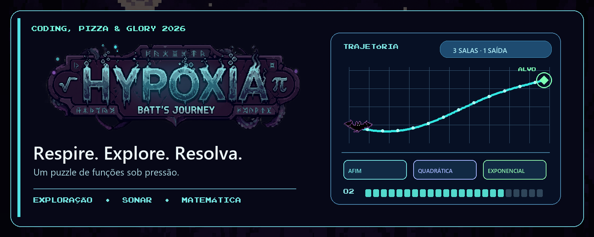

  

<h1 align="center">HYPOXIA — Ctrl+Alt+Math</h1>

  Um jogo de puzzle e exploração criado em 36 horas para o Coding, Pizza & Glory (CPG) 2026.

  
  
  
  
  

Um erro de cálculo mudou a rota do voo. Agora um morcego está preso em um porão tóxico, com pouca luz e oxigênio limitado. Para escapar, ele precisa atravessar um hub abandonado e resolver três salas de funções matemáticas.

## O jogo

- **Explore no escuro:** use o sonar para revelar o ambiente e encontrar as passagens.
- **Sobreviva ao hub:** desvie de inimigos e teias enquanto administra vidas e oxigênio.
- **Trace o caminho:** nas salas, examine funções afins, quadráticas e exponenciais, visualize as trajetórias e alcance o alvo.
- **Encontre a saída:** conclua as três salas, em qualquer ordem, para liberar a fuga.

## Jogar

Para jogar sem instalar o Godot, baixe o ZIP de **Windows** ou **Linux** na seção **Releases** deste repositório e extraia o conteúdo. No Windows, execute `windows/HYPOXIA.exe`. No Linux, abra a pasta `linux`, execute `chmod +x HYPOXIA.x86_64` uma vez e depois `./HYPOXIA.x86_64`. Mantenha o executável e o `.pck` na mesma pasta.

Cada ZIP inclui o executável, o arquivo `.pck` e a licença da fonte.

O botão **Code → Download ZIP** baixa o **projeto-fonte**. Para jogar a partir dele, siga as instruções em [Abrir o projeto](#abrir-o-projeto).

### Controles

| Tecla | Ação |
| --- | --- |
| `WASD` ou setas | Movimentar |
| `Ctrl` | Emitir um pulso de sonar |
| `Alt` | Dash, ataque e fuga das teias; consome oxigênio |
| `E` | Interagir com portas, terminais e saídas |
| `1` a `4` ou clique | Selecionar e visualizar uma trajetória nas salas |
| `Enter` | Confirmar a trajetória selecionada; avançar telas e cutscenes |
| `Esc` | Navegar pelos menus e cutscenes |

Em cada etapa das salas, o objetivo e o alvo aparecem na tela. Uma escolha incorreta consome 5 unidades de oxigênio e permite tentar novamente **na mesma etapa**, com as mesmas alternativas.

## Abrir o projeto

1. Instale o [Godot 4.6](https://godotengine.org/download) — o projeto foi validado com a versão **4.6.3**.
2. No gerenciador de projetos do Godot, escolha **Importar** e selecione `project.godot` nesta pasta.
3. Abra o projeto e pressione **F5** para jogar desde a abertura.

O projeto usa **GDScript**, tem resolução base de **1280 × 720** e não exige plugins externos.

## Organização

| Caminho | Conteúdo |
| --- | --- |
| `assets/` | Artes, animações, fonte e áudio usados pelo jogo |
| `scenes/` | Cenas do Godot: abertura, hub, salas e telas finais |
| `scripts/` | Jogabilidade, puzzles, interface e gerenciamento da partida |
| `shaders/` | Efeitos visuais |
| `docs/readme-banner.png` | Capa do repositório composta com artes do próprio jogo |
| `project.godot` | Configurações e cena inicial do projeto |
| `export_presets.cfg` | Configurações de exportação para Windows e Linux |

## Equipe

| Pessoa | Contribuição |
| --- | --- |
| **Miguel Julidori** | Programação em Godot e level design |
| **Yan Gabardo** | Pixel art, interface e animações |
| **Iury Gonçalves** | Áudio (SFX/BGM) e game design |

Desenvolvido em **36 horas** para o **Coding, Pizza & Glory (CPG) 2026**.

## Direitos de uso

**Todos os direitos reservados.** A publicação do projeto permite estudar sua implementação, mas não concede autorização para reutilizar, modificar ou redistribuir seu código e seus recursos fora das funcionalidades permitidas pela plataforma. Consulte o arquivo [LICENSE](LICENSE) e solicite permissão aos respectivos titulares antes de qualquer reutilização. Recursos de terceiros, se presentes, continuam sujeitos aos direitos de seus autores.
